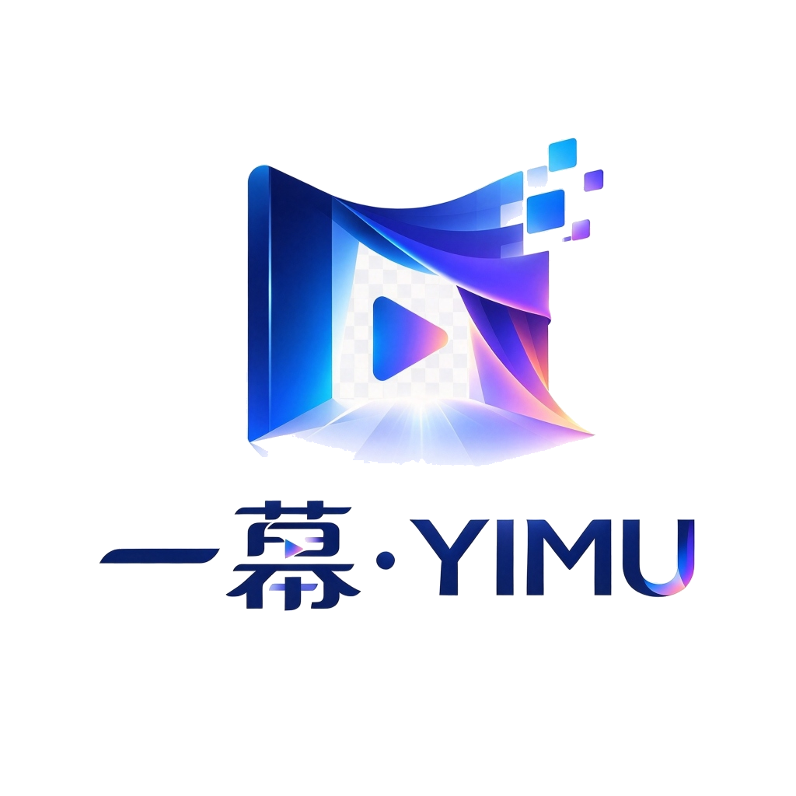
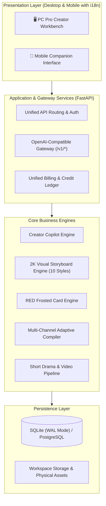

<div align="center">



# 🎬 YIMU Studio (一幕·YIMU)

**The Full-Lifecycle Viral Content Creation Engine & LLM Commercial Gateway for Digital Creators, Short Drama Studios, and MCN Agencies**

[](version.py)
[-blueviolet.svg?style=flat-square)](RELEASES.md)
[](LICENSE)
[](https://yimu.hyipf.com)
[](https://yimu.hyipf.com)
[](https://www.python.org/)
[](https://fastapi.tiangolo.com)
[](#-quick-start)
[](#-multi-language-support-i18n)
[](ci.sh)

<p align="center">
  <b>One Thought. One Scene. Infinite Worlds.</b><br>
  <i>一念起 · 一幕开 · 万象生</i>
</p>

**English** • [简体中文说明](README_ZH.md)

[✨ Features](#-core-features) • [🚀 Quick Start](#-quick-start) • [🏗️ Architecture](#-system-architecture) • [📦 Release 9.4.5](RELEASES.md) • [🛠️ Dev Guide](DEVELOPMENT.md) • [📜 License](#-license--copyright-terms)

</div>

---

## 💡 Why YIMU Studio?

In the era of AI-generated content (AIGC), creators face two fatal bottlenecks:
1. **Generic, Plastic Copywriting**: Hollow clichés, lacking deep analytical arguments and the crucial 3-second hook that stops users from scrolling.
2. **Disconnected, Low-Quality Visuals**: Blind-box image generation where illustrations bear zero relevance to article sections, often plagued by hazy fog, blurriness, or weird AI artifacts.

**YIMU Studio V9.4.5 ("澄音境" / Pristine Rhythm)** fundamentally revolutionizes AI content production:
- **Cinematic Storyboarding & 2K Crystal-Clear Image Engine**: Before generating any image, the visual agent **reads the entire article end-to-end**, extracting narrative turning points and worldview themes. Covers are mapped to Wide Establishing Shots, while sections are paired with Medium Narrative Shots or Emotional Close-ups. Powered by a specialized 2K resolution pipeline and a **zero-haze transparency prompt engineering pipeline**, visual-to-text semantic alignment is locked at **over 95%** with vivid color saturation and laser-sharp clarity.
- **Multi-Channel Native Layout Compiler**: One master draft is instantly formatted into WeChat Official Account rich-text, Toutiao information feed layout, and Xiaohongshu (RED) 5-act frosted-glass panoramic cards.
- **Dual-Device Synchronization & Commercial Gateway**: Real-time parity between Desktop Pro Workbench and Mobile Companion, featuring a unified billing/token portal and an OpenAI-compatible routing gateway.
- **Native Internationalization (i18n)**: Seamless instant one-click toggle between English and Chinese across all desktop and mobile interfaces.

---

## ✨ Core Features

### 1. 🎬 Cinematic Storyboarding & 2K Visual Engine (V9.0 Breakthrough)
- **Read First, Storyboard Next, Backfill Precisely**: Replaces random image generation with cinematic visual direction. Optical photography parameters (ARRI optics, Hasselblad medium format, Tyndall volumetric lighting, Rembrandt lighting) are woven into AI prompt generation.
- **2K Native Ultra-HD & Zero-Haze Enhancement**: Specifically tuned for Agnes and modern vision models. Employs crystal-clear prompt enforcement (`sharp focus, vibrant saturated colors, crisp details, zero haze`) while aggressively filtering out foggy, blurry, or smoke-obscured artifacts.
- **10 Curated Visual Aesthetic Presets**:
  - 📷 **Documentary Photography** (Realistic Kodak 35mm film grain)
  - 💼 **Swiss Minimalism** (Corporate elegance, cool gray negative space)
  - ✨ **Magazine Editorial** (Haute couture fashion, soft-box portraiture)
  - 🤖 **Cyberpunk Tech** (Digital future, holographic light trails)
  - 🏛️ **Classical Elegance** (Eastern ink wash, turquoise aesthetic)
  - 🏙️ **Urban Street** (Modern skyscrapers, ambient street photography)
  - 🎬 **Cinematic Blockbuster** (Anamorphic widescreen, dramatic contrast)
  - 💎 **Luxury Commercial** (Macro product details, premium studio lighting)
  - 🌅 **Healing Anime** (Makoto Shinkai / KyoAni aesthetic sky & clouds)
  - 🎨 **Minimalist 3D** (Tactile claymation, stylized volumetric art)
- **One-Click Style Hot-Swap**: Simply ask Copilot *"Change style to Cyberpunk"* or *"Switch to Makoto Shinkai anime"*, and the whole image storyboard regenerates seamlessly!

### 2. 🌐 Real-Time Viral Trend Radar
- Continuously cruises trending topics and top engagement markers across social platforms;
- Extracts verified factual evidence, controversy points, and engagement catalysts;
- Built-in compliance checks for medical claims and sensitive terms.

### 3. 📱 Multi-Channel Adaptive Layout & RED Card Forge
- **WeChat Official Account Layout**: Pixel-perfect typography, optimized line heights, margins, and inline media blocks; one-click lossless copy to WeChat Admin.
- **Xiaohongshu (RED) 5-Act Frosted Glass Cards**: Built-in Pillow graphics engine for instant rendering of 3:4 vertical HD frosted cards (Cover Card, Quote Card, Checklist Card, Action Card).
- **Toutiao High-Density Stream**: Optimized visual hierarchy for high-retention news readers.

### 4. 💬 Creator Copilot with Targeted Micro-Surgery
- **Section-Targeted Micro-Edits**: Intelligently pinpoints modification intents (e.g., *"Improve section 2"*, *"Enhance card #3"*), leaving all other text and layout untouched.
- **Headline Racing Forge**: Concurrently generates curiosity hooks, pain-point triggers, and authoritative headline variations with predicted CTR ratings.

### 5. 🎥 AI Short Drama & Avatar Video Pipeline
- Decomposes novels or narrative prose into standardized cinematic shot lists;
- Generates speech-synchronized avatar animations from a single portrait;
- Integrated Edge-TTS neural voice synthesis with multiple vocal personas.

### 6. 🏛️ Multi-Workspace Physical Isolation
- Easily create multiple distinct workspaces (e.g., *Tech Newsroom*, *Lifestyle & Beauty*, *Career Insights*);
- Completely isolates drafts, custom image libraries, skills, and persona configurations.

### 7. ⚡ Unified Commercial Billing Hub & OpenAI Gateway
- Fully compatible with standard OpenAI protocol (`/v1/chat/completions`);
- Unified billing pill: seamless integration of credit balance, subscription tier status, plan pricing, and activation key redemption;
- Real-time token metering and ledger management.

---

## 🌐 Multi-Language Support (i18n)

YIMU Studio V9.0 introduces a comprehensive internationalization engine:
- **Instant Hot-Toggle**: Switch between **English** and **简体中文 (Simplified Chinese)** with a single click on the top header button (`🌐 EN / 中文`), without page reloads.
- **Persistent Preferences**: Language preference is automatically saved locally in `localStorage` and preserved across sessions.
- **Full Coverage**: Navigation bars, toolbars, modal dialogs, status badges, and mobile interfaces are fully translated.

---

## 🏗️ System Architecture



---

## 🚀 Quick Start

### System Requirements
- **Python**: 3.12+
- **Operating System**: macOS / Linux / Windows
- **Optional**: `ffmpeg` (required for video synthesis)

### Local Setup

```bash
# 1. Clone repository
git clone https://github.com/yimuhub/yimu-baokuanstudio.git
cd yimu-baokuanstudio

# 2. Create and activate virtual environment
python3.12 -m venv .venv
source .venv/bin/activate  # Windows: .venv\Scripts\activate

# 3. Install dependencies
pip install -r requirements.txt

# 4. Configure environment
cp .env.example .env
# Edit .env to set your YIMU_SECRET_KEY and ADMIN_PASSWORD

# 5. Start the server
python -m uvicorn web.admin:app --host 127.0.0.1 --port 8790
```

### 🖥️ Cross-Platform Launch Suites (Zero Version Suffix)

- **macOS**: Double-click `一键启动.command` in the project root (`一键升级.command` for updates).
- **Windows**: Double-click `一键启动.bat` in the project root (`一键升级.bat` for updates).
- **Linux (Desktop / Server)**: Run `./一键启动_linux.sh` in terminal (`./一键升级_linux.sh` for updates).

---

### 🌐 Linux Production Server One-Click Deployment (Single Command)

For public cloud instances (Ubuntu / Debian / CentOS / Rocky / Alpine, etc.), deploy the complete production stack with automatic dependency provisioning, virtual environment isolation, cryptographic token generation, database migration, and Systemd daemon setup:

```bash
# Single-line full automated deployment for fresh cloud servers
curl -fsSL https://raw.githubusercontent.com/yimuhub/yimu-baokuanstudio/main/服务器一键部署.sh | bash

# Or run directly inside cloned repository:
chmod +x 服务器一键部署.sh && ./服务器一键部署.sh
```

Once started, open your browser and navigate to: **`http://127.0.0.1:8790/`** (Log in with your configured admin password).

---

### Docker Deployment

```bash
docker compose up -d
```

---

## 🧪 Continuous Integration & Testing

YIMU Studio enforces strict software craftsmanship with a 4-tier CI defense pipeline:

```bash
bash ci.sh
```

- ✅ **Gate 1**: 429+ automated unit and canary tests (`pytest`)
- ✅ **Gate 2**: Real-time TTS synthesis and live gateway probe
- ✅ **Gate 3**: User-facing vocabulary and terminology scanner
- ✅ **Gate 4**: Zero-credentials leak scan (strictly prevents API keys from being committed)

---

## 📦 Latest Release: V9.4.5 (澄音境 · Pristine Rhythm: Full Text Denoising)

YIMU Studio strictly implements Semantic Versioning (`SemVer`). To ensure maximum clarity and a pure presentation, the project homepage focuses exclusively on the **latest active release**:

### 🌟 V9.4.5 Feature Highlights
- 🧹 **System-Wide Text Denoising Engine (`core/text_denoise.py`)**: Completely strips intrusive visual clutter from AI generations (`***`, `---`, `___` dividers), downgrades `***bold-italic***` to clean standard `**bold**`, and converts raw `###` / `##` Markdown symbols into clean Chinese bracketed sections `【小节标题】` and natural numbers.
- 🏷️ **Strict `#` Boundary Guard**: Enforces that `#` only ever matches end-of-article tags (`#自媒体 #爆款`) and paired social media topics (`#话题名#`), completely eliminating stray `#` noise in body text.
- 🎨 **Adaptive Cross-Platform Layout Compiler**: WeChat, Toutiao, and Zhihu preview engines automatically recognize bracketed and numbered sections as styled `<h3>` headings with seamless image binding, requiring zero raw `###` syntax in markdown.
- ⚖️ **Single Source of Truth**: All components across the system strictly unified to **V9.4.5**.

> For historical version archives and detailed milestone changelogs, please visit the official [Releases Documentation (RELEASES.md)](RELEASES.md) and [GitHub Releases Page](https://github.com/yimuhub/yimu-baokuanstudio/releases).

---

## 📜 License & Copyright Terms

- **Copyright Entity & Licensor**: [yimu.hyipf.com](https://yimu.hyipf.com)
- **Copyright Notice**: Copyright © 2026 [yimu.hyipf.com](https://yimu.hyipf.com). All rights reserved.
- **License**: **Business Source License 1.1 (BSL 1.1 / BUSL-1.1)**

### 📄 Commercial Terms & Use Grant
- 🎁 **Free for Individuals & Creators**: Personal learning, research, non-commercial use, and personal digital creator workflows (including ad and e-commerce affiliate revenues earned via personal social media channels) are **100% free forever without requiring commercial authorization**.
- 💼 **Small & Micro Commercial Exemption**: Any entity whose commercial revenue directly generated through this software is below RMB ¥100,000 (or equivalent USD) in any consecutive 12-month period is **completely exempt from licensing fees**.
- 🏢 **Scaled Enterprise Licensing**: Commercial usage exceeding RMB ¥100,000 or SaaS platform operation requires official commercial authorization from **yimu.hyipf.com** (Free registration or tiered agreements available; contact: `yimu@hyipf.com`).
- 🔄 **Automatic Open Source Conversion**: Exactly four years after the public release date of each version, that version automatically converts to the fully open-source **Apache License 2.0**.

For full legal terms, please read [LICENSE](LICENSE).

---

<div align="center">
  <sub>Copyright © 2026 <a href="https://yimu.hyipf.com">yimu.hyipf.com</a> · All rights reserved.</sub>
</div>
