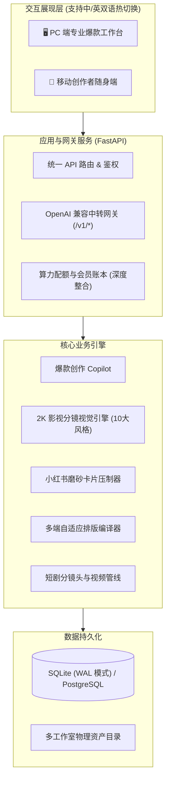

<div align="center">

# 🎬 一幕·YIMU 爆款工作室 (YIMU Studio)

**面向自媒体创作者、短剧团队与 MCN 机构的全链路爆款生产引擎 + 大模型商业网关**

[](version.py)
[](LICENSE)
[](https://www.python.org/)
[](https://fastapi.tiangolo.com)
[](#-快速启动)
[](ci.sh)

<p align="center">
  <b>一念起 · 一幕开 · 万象生</b><br>
  <i>One Thought. One Scene. Infinite Worlds.</i>
</p>

[English](README.md) • **简体中文**

[✨ 功能特性](#-核心特性矩阵) • [🚀 快速启动](#-快速启动) • [📖 系统功能说明书](docs/系统功能说明书.md) • [🏗️ 系统架构](#-系统架构) • [📜 开源协议](#-开源许可与商业授权) • [📦 发行说明](RELEASES.md)

</div>

---

## 💡 为什么选择「一幕·YIMU」？

在当今内容创作与 AI 生成的时代，绝大多数 AI 写作工具普遍存在两大核心痛点：
1. **文案假大空、塑料感严重**：生成套话堆砌，缺乏深度论据与抓人眼球的黄金前 3 秒；
2. **配图与内容割裂脱节**：盲盒式生图，生成的图片与文章段落风马牛不相及，甚至出现廉价怪异的 AI 塑料感与灰蒙蒙的烟雾模糊感。

**一幕·YIMU V9.1.0（万象生 · Infinite Worlds）** 从底层彻底颠覆这一现状：
- **影视短剧分镜法则 + 2K 超清通透画质引擎**：在生成任何一张图片前，Agent **必须先通读全文**，提炼世界观与论述转折，将封面定义为宏大建立镜头（Wide Establishing Shot），各小节定义为叙事中景与情绪特写（Medium Narrative Shot / Close-up）。全新接入 2K 级超清原生画质标准与**零烟雾通透增强算法**，彻底剔除朦胧虚幻感，色彩艳丽、锐度极致，**图文匹配度硬性锁定在 95% 以上**；
- **全渠道原生排版**：一份核心爆款母本，秒级自动编译为微信公众号富文本、今日头条高密度资讯流、小红书 5 幕磨砂毛玻璃卡片；
- **多端与双核驱动**：PC 操盘大台与移动随身端数据全域互联，内置兼容 OpenAI 的聚合网关与算力统一账本；
- **全球化双语原生引擎 (i18n)**：全站支持中英双语自由热切换，适配国际自媒体运营与出海团队。

---

## ✨ 核心特性矩阵

### 1. 🎬 影视级分镜头配图与 2K 顶级画质 (V9.0.0 核心飞跃)
- **先通读、再分镜、精回填**：彻底告别盲盒出图，将摄影光学参数（ARRI / 哈苏中画幅 / 丁达尔体积光 / 伦勃朗布光）注入 AI 提示词底层；
- **2K 原生超清与零烟雾通透提示词管线**：全面适配 Agnes 等顶级图像大模型，强制注入 `crystal-clear sharp focus, vibrant saturated colors, crisp details` 等高清关键词，坚决排除 `foggy, hazy, smoke, blurry` 等朦胧负向词；
- **十大前沿视觉美学系统**：
  - 📷 **纪实摄影**（生活烟火·柯达胶片质感）
  - 💼 **瑞士极简**（商业质感·冷灰留白）
  - ✨ **杂志编辑**（高端时尚·柔光人像）
  - 🤖 **科技赛博**（数字未来·全息光轨）
  - 🏛️ **古风雅韵**（东方意境·水墨青绿）
  - 🏙️ **城市风**（现代摩天·街拍光影）
  - 🎬 **影视大片**（电影宽画幅·戏剧张力）
  - 💎 **高端商业**（品牌广告·微距细节）
  - 🌅 **治愈动漫**（新海诚/京阿尼唯美光影、积雨云）
  - 🎨 **极简三维**（轻拟物艺术·粘土立体）
- **创作者 Agent 聊天一键换图**：与 Agent 对话时只需说一句“换成古风”、“改成科技风”或“换成新海诚风格”，全套分镜与正文自动热重载！

### 2. 🌐 全网爆款雷达与情报巡航
- 实时捕获各大内容平台热搜高权重情报；
- 提炼高阅读量文章事实论据与核心矛盾，严禁凭空捏造；
- 医疗词与违规敏感词前置合规拦截。

### 3. 📱 多端自适应排版与小红书卡片工坊
- **微信公众号美学排版**：优化字距、行高、留白与配图排布，支持一键无损复制至微信后台；
- **小红书 5 幕全景磨砂卡片工坊**：Pillow 离线图形引擎快速压制，自动生成 3:4 竖屏高清全景毛玻璃卡片（封面卡、金句卡、干货清单卡、行动卡）；
- **今日头条高信息密度流**：针对资讯类读者深度优化视觉重心。

### 4. 💬 创作者 Copilot 与微创手术精修
- **段落级微创手术**：精准识别指定段落改写意图（如“优化第二段”、“加强小红书第3张卡片”），其余正文与排版毫厘不损；
- **标题赛马锻造池**：批量生成数字悬念型、痛点共鸣型、权威背书型等高点击率标题。

### 5. 🎥 AI 短剧与数字人视频工坊
- 一键将小说/故事分解为标准影视分镜头脚本；
- 上传单张照片驱动数字人，生成高一致性视频分段；
- 免费 Edge-TTS 超拟人配音与即时声音克隆。

### 6. 🏛️ 多工作室独立空间 (Workspace) 完全隔离
- 支持创建多个独立工作室空间（如“科技矩阵”、“生活笔记”、“职场干货”）；
- 创作草稿、专属配图、知识库技能、人设配置完全物理隔离。

### 7. ⚡ 内置大模型中转网关与算力统一中枢
- 兼容标准 OpenAI 协议（`/v1/chat/completions`）；
- 商业化算力与会员套餐深度合并统一（套餐状态、权益价格、算力余额与卡密核销一步到位）；
- 统一会员体系与 Token 计费账本。

---

## 🏗️ 系统架构



---

## 🚀 快速启动

### 环境要求
- **Python**: 3.12+
- **操作系统**: macOS / Linux / Windows
- **可选依赖**: ffmpeg（视频合成需要）

### 本地部署运行

```bash
# 1. 克隆仓库
git clone https://github.com/yimuhub/yimu-baokuanstudio.git
cd yimu-baokuanstudio

# 2. 创建并激活虚拟环境
python3.12 -m venv .venv
source .venv/bin/activate  # Windows 用户: .venv\Scripts\activate

# 3. 安装依赖包
pip install -r requirements.txt

# 4. 配置环境变量
cp .env.example .env
# 编辑 .env 文件，填写 YIMU_SECRET_KEY 与 ADMIN_PASSWORD

# 5. 启动开发服务
python -m uvicorn web.admin:app --host 127.0.0.1 --port 8790
```

> **快捷脚本**：
> - **macOS 用户**：直接双击运行根目录下的 `启动一幕V8.command` 即可一键启动！
> - **Windows 用户**：直接双击运行根目录下的 `启动一幕V8.bat` 即可！

启动完成后，打开浏览器访问：**`http://127.0.0.1:8790/`**（默认管理员密码见 `.env` 设置）。

---

### Docker 容器化启动

```bash
docker compose up -d
```

---

## 🧪 持续集成与质量测试

本项目具备完善的工程化测试与四道防线门禁：

```bash
bash ci.sh
```

- ✅ **第 1 步**：429+ 项单元测试与金丝雀测试（pytest）
- ✅ **第 2 步**：真实语音生成与网关调用活体探针
- ✅ **第 3 步**：用户文案术语规范扫描（严防内部黑话暴露）
- ✅ **第 4 步**：全量代码敏感凭证扫描（严禁任何 API Key 入库）

---

## 📦 版本演进与升级路径（V8.3.33 vs V9.0.0）

一幕·YIMU 团队恪守语义化版本标准（Semantic Versioning）：**老版本永久归档保留，新版本直接上传发布，升级路径清晰透明。**

### 📊 核心版本差异矩阵

| 核心维度 | V8.3.33 (上一稳定归档版本) | V9.0.0 (最新旗舰大版本) | 升级演进说明 |
|---|---|---|---|
| **配图默认分辨率** | 1024x1024 (标准 1K 画幅) | **2048x1152 / 1152x2048 / 2048x2048 (原生 2K)** | 极简与灵感模式出图清晰度全面提升，细节纤毫毕现 |
| **画面通透感** | 易产生灰蒙蒙的雾感与烟雾朦胧 | **零烟雾通透滤镜 (Zero-Haze Pipeline)** | 强力注入高饱和高锐度提示词，负向剔除 fog/smoke/blur |
| **生图大模型适配** | 基础生图接口，易触发 400 报错 | **Agnes 图像大模型深度协议对齐** | 严格规范尺寸，内置 400 智能自愈与重试保护 |
| **商业化与算力入口** | 顶栏按钮割裂、含外部版本号跳转链接 | **商业化算力与套餐价格深度合并统一胶囊** | 彻底下线冗余跳转页，算力/套餐/卡密一站式极速弹窗 |
| **国际化多语言** | 仅支持简体中文单语言 | **中英双语 (i18n) 全域即时热切换** | Desktop 与 Mobile 双端支持，GitHub 纯英文专业说明 |
| **账号安全与管理** | 无法自主修改登录口令 | **个人中心与口令弹窗集成修改密码** | 后端 `/api/auth/change_password` 严格校验加密更新 |
| **GitHub 归档管理** | `git tag v8.3.33` 独立归档冻结 | `git tag v9.0.0` (Latest 旗舰版) | 老版本保持冻结原貌不变，新版本直推发布 |

### 🧭 如何在 GitHub / 本地切换新旧版本
- **使用最新 V9.0.0（万象生）**：
  ```bash
  git checkout v9.0.0
  ```
- **回滚或使用老版本 V8.3.33**：
  ```bash
  git checkout v8.3.33
  ```

---

## 📖 详细系统文档

想要了解更详细的系统设计与功能操作指引，请参阅：
- 📘 **[系统功能说明书 (完整操作与业务指南)](docs/系统功能说明书.md)**
- 📦 **[版本发布日志 (RELEASES.md)](RELEASES.md)**
- 📝 **[版本变更日志 (CHANGELOG.md)](CHANGELOG.md)**
- 🤝 **[贡献指南 (CONTRIBUTING.md)](CONTRIBUTING.md)**
- 🔒 **[安全政策 (SECURITY.md)](SECURITY.md)**
- 📝 **[问题修复与迭代记录](问题修复记录.md)**

---

## 📜 开源许可与商业授权

本项目源代码采用 **Business Source License 1.1 (BSL 1.1)** 许可证发布：

- 🎁 **免费个人与创作者使用**：个人学习、科学研究、非商业用途、以及个人自媒体内容创作（包括通过个人自媒体账号获得的广告收益与带货收益）**永久免费，无需申请授权**；
- 💼 **小微商用免授权**：任何主体在连续 12 个月内通过本作品直接产生的商业价值低于人民币 10 万元的，**完全免费，无需申请授权**；
- 🏢 **规模商业授权**：商业价值达到或超过人民币 10 万元的规模化商用或 SaaS 平台运营，须取得官方商业授权登记（可免费登记或协议阶梯定价，联系邮箱：yimu@yimu.hyipf.com）；
- 🔄 **公版自动转换**：每个版本自公开发布之日起满四年后，自动转换为完全自由的 **Apache License 2.0** 协议。

详细条款请参阅 [LICENSE](LICENSE)。

---

<div align="center">
  <sub>Made with ❤️ by 一幕·YIMU 团队</sub>
</div>
