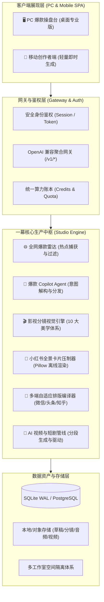

# 一幕·YIMU 爆款工作室 V8.3.32 系统功能说明书

> **产品代号**：星河引 (Galaxy Muse)  
> **核心愿景**：一念起 一幕开 万象生 (One Thought. One Scene. Infinite Worlds.)  
> **适用版本**：V8.3.32 (单一真源 Release)

---

## 目录

- [第一章 产品概述与核心理念](#第一章-产品概述与核心理念)
- [第二章 系统整体架构全景图](#第二章-系统整体架构全景图)
- [第三章 核心功能模块全解析](#第三章-核心功能模块全解析)
  - [3.1 操盘大屏与全网爆款雷达](#31-操盘大屏与全网爆款雷达)
  - [3.2 灵感生成器与一句话爆款创作](#32-灵感生成器与一句话爆款创作)
  - [3.3 内容工作台与深度微创精修](#33-内容工作台与深度微创精修)
  - [3.4 影视短剧级分镜头视觉配图引擎](#34-影视短剧级分镜头视觉配图引擎)
  - [3.5 全渠道多端自适应排版与小红书卡片工坊](#35-全渠道多端自适应排版与小红书卡片工坊)
  - [3.6 AI 短剧与数字人视频工坊](#36-ai-短剧与数字人视频工坊)
  - [3.7 多工作室工作区与租户隔离体系](#37-多工作室工作区与租户隔离体系)
  - [3.8 大模型聚合中转网关与统一账本](#38-大模型聚合中转网关与统一账本)
- [第四章 快速部署与运维指南](#第四章-快速部署与运维指南)
- [第五章 开发者扩展与二次开发](#第五章-开发者扩展与二次开发)
- [第六章 开源协议与商业授权说明](#第六章-开源协议与商业授权说明)

---

## 第一章 产品概述与核心理念

**一幕·YIMU 爆款工作室** 是一款专为自媒体创作者、内容操盘手、MCN 机构与影视短剧团队打造的**全链路爆款内容生产与自动化分发引擎**。

系统以大模型 Agent 矩阵为大脑，深度融合**影视短剧分镜头镜头语言**、**全网实时高流量舆情雷达**、**自适应多端高保真排版**以及**内置大模型商业网关**，实现从一个灵感、一句话热点到公众号深度图文、今日头条高密度资讯、小红书全景磨砂卡片以及 AI 数字人分镜短剧的全流程工业化交付。

### 核心设计原则
1. **真实交付，拒绝塑料感**：拒绝空泛的套话与盲盒式图片生成，坚持“先通读全文、再总结分镜、精准匹配段落”的影视级工业标准。
2. **多端自适应原生排版**：一份核心爆款母本，自动编译为微信公众号（曹操/美学主题）、今日头条（高密度新闻流）、小红书（5 幕磨砂毛玻璃卡片矩阵）等原生规范，无需人工二次调整排版。
3. **物理级数据隔离**：支持多工作室空间（Workspaces）完全隔离，创作资产、草稿物料、声音模型、专属人设互不串扰。
4. **单体轻量与云原生兼备**：单机模式依赖极简（内置 SQLite WAL + 原生 SPA，一键脚本双击即跑），同时原生支持 Docker 容器化与云端分布式部署。

---

## 第二章 系统整体架构全景图

系统采用双核驱动架构：**内容生产中枢 (Studio Engine)** 与 **大模型聚合网关 (YIMU Gateway)** 深度互联，共享统一身份与算力账本。



---

## 第三章 核心功能模块全解析

### 3.1 操盘大屏与全网爆款雷达
- **热点情报自动巡航**：全天候多源抓取主流平台（知乎、微博、头条、全网资讯）热搜与热榜高权重文章；
- **爆款基因提炼**：自动清洗低质信息与重复新闻，提取核心争议点、事实论据与数据佐证；
- **合规前置拦截**：内置敏感词过滤与伪医疗/违规内容安全护栏，不合规选题自动阻断于待采池前。

### 3.2 灵感生成器与一句话爆款创作
- **一句话生文**：只需输入一句话观点或新闻线索，Agent 自动补全黄金前 3 秒钩子、三段式冲突展开、有力论据与行动倡议 (CTA)；
- **预设人设挂载**：可绑定商业分析师、情感作家、科技极客、个人成长导师等多种自媒体专属语气人设；
- **全端协同生成**：创稿瞬间自动联动小红书卖点解构器与全套插图绘制管线。

### 3.3 内容工作台与深度微创精修
- **多端分屏实时渲染**：左侧 Markdown 源码与创作微创操作区，右侧 100% 还原真实 App 阅读体验（微信公众号手机视窗、今日头条新闻卡片、小红书卡片滑块）；
- **段落级“微创手术”改写**：创作者可在聊天中指定“第 2 段加强痛点情绪”或“改写小红书第 3 张卡片”，Agent 定点重塑指定位置，其余正文与排版毫厘不差；
- **标题赛马锻造池**：自动生成包含数字悬念型、痛点共鸣型、权威背书型、情绪反差型等 5~10 组高点击标题，支持一键替换。

### 3.4 影视短剧级分镜头视觉配图引擎
> **核心铁律**：Agent 必须先通读文稿全部内容，再解构出结构化分镜头剧本，图文匹配度锁定 95% 以上。

- **分镜语法标准**：
  - **封面大图**：Wide Establishing Hero Shot 全景建立镜头，奠定宏大视觉基调；
  - **各节插图**：Medium Narrative Shot 叙事中景与情绪特写，1:1 锚定正文各论述段落；
- **十大前沿视觉美学预设**：
  1. `documentary`：纪实摄影·生活烟火（Kodak Portra 400 胶片颗粒感）
  2. `swiss_minimal`：瑞士极简·商业质感（大面积负空间、冷灰基调）
  3. `magazine_editorial`：杂志编辑·高端生活方式（柔光箱、奢华时尚排版质感）
  4. `tech_cyber`：科技赛博·数字未来感（全息投影蓝青冷色调）
  5. `ancient_chinese`：古风雅韵·东方意境（水墨留白、工笔细腻青绿设色）
  6. `city_urban`：城市风·现代都市摩天（广角透视、冷暖交织街道光影）
  7. `cinematic_movie`：影视大片·电影光影（ARRI 摄影机、电影宽画幅、强烈戏剧布光）
  8. `commercial_premium`：高端商业·品牌广告（哈苏商业中画幅、微距质感）
  9. `anime_cinematic`：治愈动漫·新海诚光影（新海诚/京阿尼唯美光影、积雨云、丁达尔光线）
  10. `minimalist_3d`：极简三维·轻拟物艺术（粘土拟物风、马卡龙柔和色调）
- **创作 Agent 聊天一键换图**：聊天时只需说“换成古风”、“改成科技风”、“换成新海诚风格”或“按极简3D重新配图”，系统全自动重解构分镜并热重载画布。

### 3.5 全渠道多端自适应排版与小红书卡片工坊
- **微信公众号排版引擎**：内置美学主题渲染，优化字间距、行高、引用块与图片边距，支持一键富文本复制，直连微信公众平台后台无损粘贴；
- **小红书 5 幕全景磨砂卡片工坊**：
  - 基于 Pillow 纯本地硬件加速图形引擎，离线压制；
  - 自动提炼封面卡、金句卡、干货清单卡、认知反差卡与行动收口卡；
  - 自动生成 3:4 竖屏高清大图与完整图文笔记 Markdown，支持批量图片一键下载。

### 3.6 AI 短剧与数字人视频工坊
- **一键短剧剧本分拆**：输入剧情梗概，自动分解为标准分镜头台本（景别、运镜、角色台词、音效提示、画面描写）；
- **专属照片驱动数字人**：上传正面照片，AI 自动绑定面部并生成高一致性视频画面；
- **声音克隆与配音合成**：支持 Edge-TTS 免费超拟人配音与短音频即时声音克隆，音画节奏精准对齐。

### 3.7 多工作室工作区与租户隔离体系
- **多工作区切换**：支持团队创建多个相互独立的工作室空间（如“科技前沿矩阵”、“生活美学笔记”、“职场干货营”）；
- **完全资产隔离**：草稿文章、专属配图、知识库技能、人设配置在工作区之间物理隔离，权限隔离；
- **安全审计日志**：自动记录工作区操作流水与生成计费审计日志。

### 3.8 大模型聚合中转网关与统一账本
- **标准 OpenAI 协议接入**：提供 `/v1/chat/completions` 与 `/v1/models` 接口，支持无缝接入 NextChat、ChatBox 等外部第三方客户端；
- **三方聚合通道热切换**：支持自定义配置官方通道、API 池与自建聚合中转站；
- **Token 算力统一计费**：创作端、微创改写、分镜生图、网关调用统一扣除 Credits 额度，透明可查。

---

## 第四章 快速部署与运维指南

### 方式一：macOS / Linux 一键本地运行（推荐）

```bash
# 1. 克隆代码仓库
git clone https://github.com/yimuhub/yimu-baokuanstudio.git
cd yimu-baokuanstudio

# 2. 创建并激活 Python 3.12 虚拟环境
python3.12 -m venv .venv
source .venv/bin/activate

# 3. 安装依赖
pip install -r requirements.txt

# 4. 配置环境变量
cp .env.example .env
# 编辑 .env 设置 YIMU_SECRET_KEY 与 ADMIN_PASSWORD

# 5. 启动服务（macOS 可直接双击运行 "启动一幕V8.command"）
python -m uvicorn web.admin:app --host 127.0.0.1 --port 8790
```

打开浏览器访问 `http://127.0.0.1:8790/` 即可进入工作台。

### 方式二：Docker 容器化部署

```bash
# 使用 Docker Compose 一键启动
docker compose up -d
```

### 持续集成与质量检验
在提交代码或合并发布前，建议运行完整的四道质量门禁验证：
```bash
bash ci.sh
```
确保以下四步全部通过：
1. 单元测试（pytest 全部 433+ 项通过）
2. 真实功能探针（语音与网关链路可用）
3. 术语检查（严防内部黑话露出）
4. 密钥安全扫描（杜绝任何 API Key 进仓库）

---

## 第五章 开发者扩展与二次开发

### 1. 扩充全新的分镜头图片风格
在 `core/imagegen.py` 的 `VISUAL_STYLE_PRESETS` 字典中添加新配置：
```python
"cyberpunk_neon": {
    "name": "赛博朋克·霓虹夜市",
    "tag": "赛博霓虹",
    "style_directive": "Cyberpunk aesthetic with vibrant neon lights, raining night streets...",
    "suffix": "masterpiece, 8k, cinematic lighting, no text, no watermark"
}
```
并在 `core/copilot.py` 的 `VISUAL_STYLE_KEYWORDS` 中加入触发中文关键词即可自动联动 Agent 聊天。

### 2. 扩充平台排版适配器
在 `adapters/` 目录下新增平台渲染器（例如 `adapters/bilibili.py`），实现 `render_preview(body_md, title)` 即可无缝扩充到分发矩阵中。

---

## 第六章 开源协议与商业授权说明

本项目开源代码基于 **Business Source License 1.1 (BSL 1.1)** 许可发布：
- **免费个人与创作者使用**：个人学习、技术研究、非商业用途以及个人自媒体创作（包括自媒体账号的流量收益、带货收益）**完全免费，无需申请授权**；
- **小微商用免授权**：任何主体连续 12 个月内通过本作品直接产生的商业价值低于人民币 10 万元的，**完全免费，无需申请授权**；
- **规模商业授权**：商业价值超过 10 万元的商业化部署或 SaaS 运营，须获得官方商业授权登记（可免费登记或协商阶梯协议）；
- **公版转换保障**：根据 BSL 1.1 规范，每个版本公开发布满四年后，自动转换为绝对开放的 **Apache License 2.0**。
