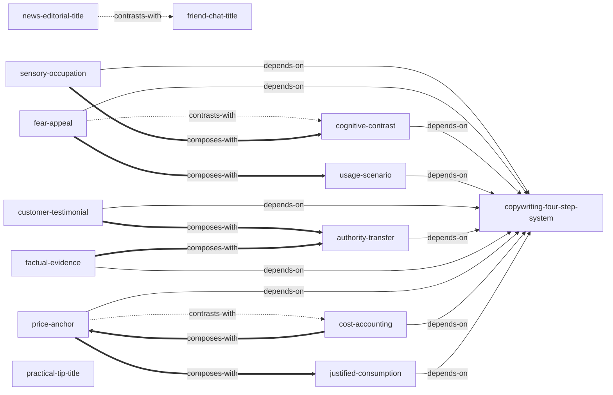

# 爆款文案 — Skill Index

> 本书由 [cangjie-skill](https://github.com/kangarooking/cangjie-skill) 蒸馏, 共产出 **14** 个 skills。
> 处理时间: 2026-05-02

## 关于这本书

- **作者**: 关健明
- **出版年**: 2017
- **一句话主旨**: 用文案卖货只需四步：标题抓眼球→激发购买欲→赢得信任→引导马上下单，每步都有可复用的具体方法
- **整书理解**: 见 [BOOK_OVERVIEW.md](./BOOK_OVERVIEW.md)

---

## Skill 列表 (按主题分组)

### 元框架

- [`copywriting-four-step-system`](./copywriting-four-step-system/SKILL.md) — 文案卖货四步骤系统，诊断+组合其他skill的总方法

### 激发购买欲望

- [`sensory-occupation`](./sensory-occupation/SKILL.md) — 六感描写让读者"文字试用"产品
- [`fear-appeal`](./fear-appeal/SKILL.md) — 痛苦场景+严重后果两步法激发紧迫感
- [`cognitive-contrast`](./cognitive-contrast/SKILL.md) — 先竞品弱点后我方优势，利用对比原理放大差异
- [`usage-scenario`](./usage-scenario/SKILL.md) — 设计具体场景帮懒惰读者"看到"使用画面
- [`customer-testimonial`](./customer-testimonial/SKILL.md) — 精选击中核心需求的真实评价+畅销暗示

### 赢得读者信任

- [`authority-transfer`](./authority-transfer/SKILL.md) — 权威高地位+高标准两步嫁接
- [`factual-evidence`](./factual-evidence/SKILL.md) — 精确数据链接熟悉事物+实验法创造视觉对比

### 引导马上下单

- [`price-anchor`](./price-anchor/SKILL.md) — 高价参照物+实际低价对比，含惊喜优惠标题变体
- [`cost-accounting`](./cost-accounting/SKILL.md) — 平摊到每天或计算长期节省，消除价格心理障碍
- [`justified-consumption`](./justified-consumption/SKILL.md) — 把购买重构为上进/送礼/健康/孩子四类正当理由

### 标题写作

- [`news-editorial-title`](./news-editorial-title/SKILL.md) — 新闻主角+即时性词+重大新闻词
- [`friend-chat-title`](./friend-chat-title/SKILL.md) — "你"+口语词+惊叹词
- [`practical-tip-title`](./practical-tip-title/SKILL.md) — 具体苦恼+完美结局/破解方法

---

## 引用图



图例:
- `-->`  depends-on
- `-.->` contrasts-with
- `===>` composes-with

---

## 推荐学习顺序

1. **copywriting-four-step-system** — 元框架，理解四步漏斗全貌
2. **sensory-occupation** — 最常用，几乎所有ToC产品都需要
3. **fear-appeal** — 对转化率提升最直接
4. **cognitive-contrast** — 简单高效，适合成熟品类
5. **usage-scenario** — 新产品上市关键
6. **customer-testimonial** — 效果型产品的最佳武器
7. **authority-transfer** — 中小品牌最缺乏也最需要
8. **factual-evidence** — 数据翻译是硬技能
9. **price-anchor** — 立竿见影的促单手段
10. **cost-accounting** — 高价产品必备
11. **justified-consumption** — 非刚需产品的转化利器
12. **friend-chat-title** — 最容易上手的标题技巧
13. **news-editorial-title** — 适合有新闻价值的产品
14. **practical-tip-title** — 痛点明确的产品首选

---

## Generated by Cangjie Skill

本仓库由 [cangjie-skill](https://github.com/kangarooking/cangjie-skill) 生成——一个把书蒸馏成可执行 AI skills 的开源工具链。

cangjie-skill 基于 RIA-TV++ 方法论，将书籍中的方法论、框架、原则提取为原子化的 skill，可被 AI agent 在真实场景中直接调用。

---

## 接入 darwin-skill

所有 skill 均带有 `test-prompts.json` (darwin-skill 兼容格式), 可直接接入自动进化:

```
darwin evolve books/viral-copywriting-skill/
```

---

## 审计轨迹

- 候选单元池: [candidates/](./candidates/)
- 被淘汰的候选 (含原因): [rejected/](./rejected/)
- BOOK_OVERVIEW: [BOOK_OVERVIEW.md](./BOOK_OVERVIEW.md)
